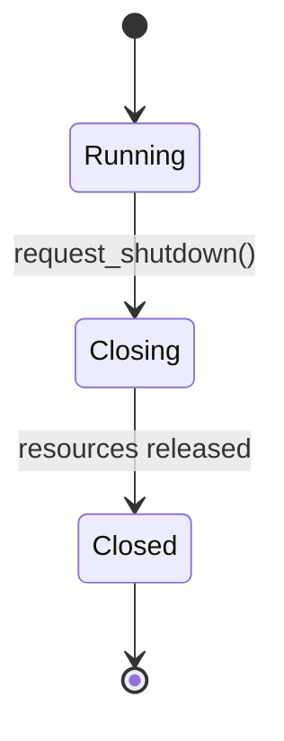
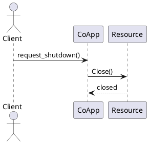

# 图表与关系图

## Graphviz

Doxygen 的 `HAVE_DOT = YES` 可调用 Graphviz `dot` 生成继承、include、类/成员关系以及可选调用/被调用图。它表达的是源码可观察关系，不等于运行时实际时序或业务架构。

建议默认：

```text
HAVE_DOT = YES
UML_LOOK = YES
CALL_GRAPH = NO
CALLER_GRAPH = NO
DOT_IMAGE_FORMAT = svg
```

调用图可能很大、慢且噪声高；按页面或任务显式开启，不把全仓调用图作为默认门禁。缺 `dot` 时保留文字文档并把图状态记为未生成，不伪造通过。

## Mermaid

状态图、时序图、流程图和架构草图优先保留 Mermaid 源码：

````markdown

````

Mermaid 源文件是设计表达，不由 Doxygen 从 C++ 自动生成。站点是否渲染 Mermaid 由宿主决定；Doxygen 新版本可处理 Mermaid 命令，但版本和输出模式需实测，不把文档站的 Mermaid 能力倒推给所有 Doxygen 版本。

## PlantUML

既有 UML 或需要 PlantUML 生态时保留 `.puml`：



PlantUML 通常需要 Java 和固定版本的 JAR；`PLANTUML_JAR_PATH` 只在真实依赖已准备并获授权后填写。源文件、工具版本和渲染命令必须可复现，不能只提交截图。

## 选择原则

- 代码结构事实：Doxygen + Graphviz。
- 状态/时序/架构意图：Mermaid 或 PlantUML 源。
- 不能用自动图替代 ADR、契约或真实运行证据。
- 图表节点、箭头和标签若代表运行行为，必须标注“设计/实测/示意”中的一种。
